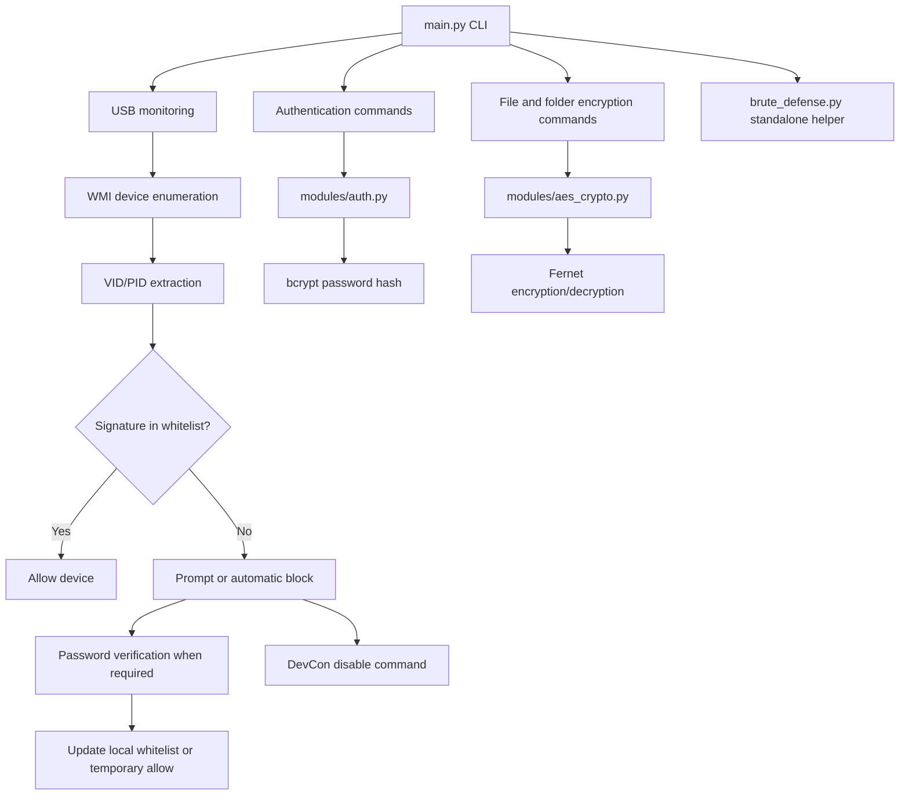

# SecureUSB Architecture

## High-level flow

## Components

| Component | Responsibility |
|---|---|
| `main.py` | Command-line interface, USB polling loop, command dispatch, optional event logging |
| `modules/detection.py` | Load/update whitelist, extract VID/PID, enumerate devices, invoke DevCon |
| `modules/auth.py` | Create and verify the administrator password hash with bcrypt |
| `modules/aes_crypto.py` | Derive a Fernet-compatible key and encrypt/decrypt files and folder contents |
| `brute_defense.py` | Standalone in-memory failed-attempt counter and temporary lockout helper |
| `generate_whitelist.py` | Discover connected USB disk drives and write their VID/PID signatures to the local whitelist |
| `data/` | Local runtime configuration and password hash; sensitive runtime files are excluded from Git |

## Monitoring sequence

1. `main.py monitor` loads the whitelist and creates a WMI connection.
2. It polls Plug and Play entities at the configured interval.
3. It extracts VID/PID signatures and compares them with the whitelist.
4. Authorized devices are logged. Unknown devices are prompted or automatically passed to the blocking routine.
5. The blocking routine asks DevCon to disable matching device instances.

This describes the current code, not a guarantee that every USB storage device or every type of USB peripheral will be blocked successfully.
