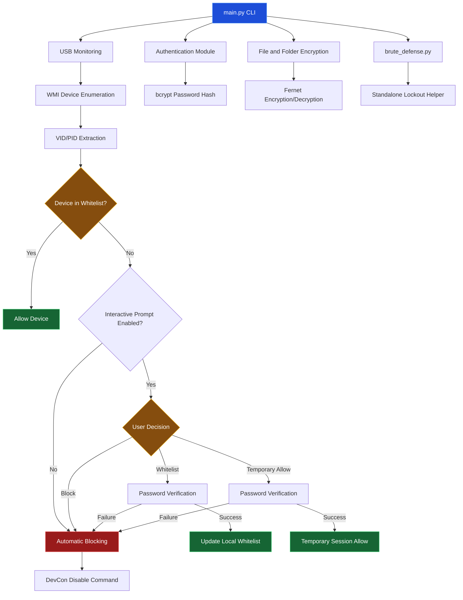

# SecureUSB Architecture

## System Architecture Diagram

## Component Description

| Component | Responsibility |
|---|---|
| main.py | Main application and CLI |
| detection.py | USB detection and device control |
| auth.py | Password authentication |
| aes_crypto.py | File and folder encryption |
| brute_defense.py | Brute-force protection helper |
| generate_whitelist.py | USB whitelist generation |
